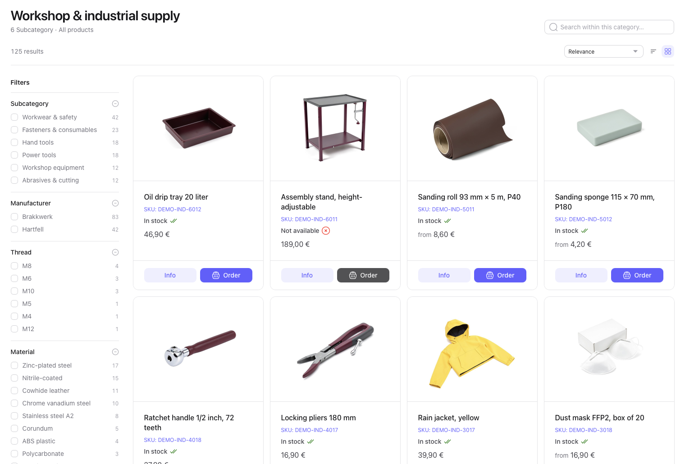
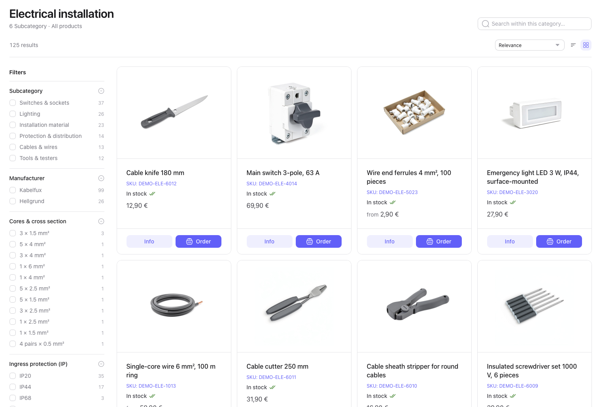
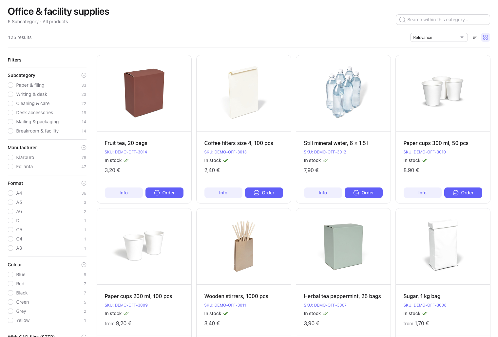
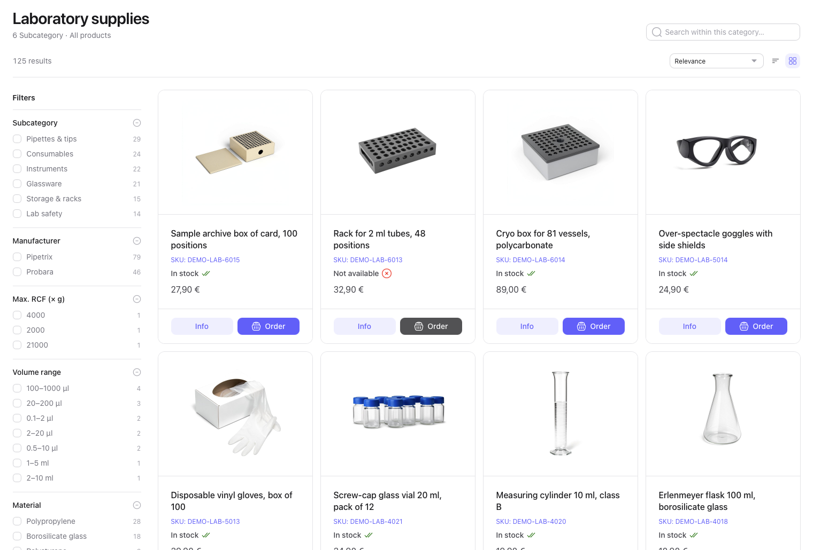
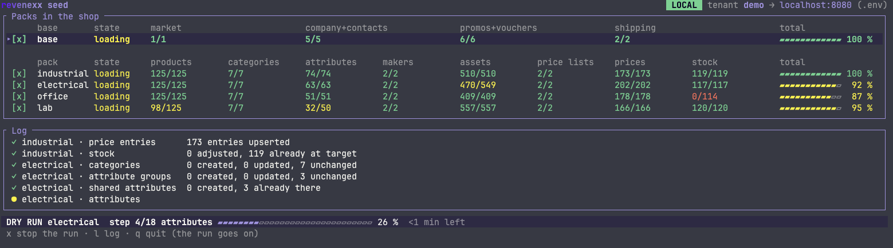

# revenexx sample data

A ready-made B2B shop for your revenexx tenant: four industry catalogues with prices, stock, images, drawings and 3D models, plus a buyer company and promotions. Start `./sample-data`, pick what you want, and it loads or removes it for you.

Use it to see revenexx working with realistic data before your own catalogue is in, to follow a B2B order from price to placement, or to test an ERP or PIM integration against records you know.

- [What you get](#what-you-get)
- [Before you start](#before-you-start)
- [Load it](#load-it)
- [Try these](#try-these)
- [Remove it](#remove-it)
- [Without a terminal](#without-a-terminal)
- [How it works](#how-it-works)
- [What it changes on your tenant](#what-it-changes-on-your-tenant)
- [Build your own pack](#build-your-own-pack)
- [Licence](#licence)

## What you get

A load brings the **packs** you choose, and the **base** they need (it is skipped when it is already complete).

| | What's in it |
| --- | --- |
| **Base** | A market `demo_de` (Germany, EUR, German and English, 19 % and 7 % VAT) and the buyer company *Muster Bau & Technik GmbH*, with a buyer, an approver, and billing and shipping addresses. Also an automatic promotion (5 % off from 100 €), two voucher codes and a shipping method priced by weight. The base also calls your tenant's setup routes, which create the standard sales channel and channel types, shipping carriers and methods, payment methods, order and return number ranges, customer roles and value lists (payment terms, lifecycle stages), the standard price list, and the stock location `main` with its availability states if they are missing, and leave existing ones alone. |
| **`industrial`** | Workshop and industrial supply: power tools, fasteners, safety gear, hand tools, abrasives, workshop equipment. 101 products, 6 of them work gloves in 4 sizes. |
| **`electrical`** | Electrical installation: cables, switches and sockets, lighting, protection and distribution, installation material, tools and testers. 99 products, 8 of them in several colours. |
| **`office`** | Office and facility supplies: paper and filing, writing, breakroom, desk accessories, cleaning, mailing and packaging. 94 products, 9 of them in several colours. |
| **`lab`** | Laboratory supplies: instruments, pipettes and tips, consumables, glassware, lab safety, storage and racks. 112 products, 5 of them pipettes in several volume ranges. |

Each pack has the following:

- **6 categories** under its own root category.
- **Typed attributes** (with units and options) on one product family.
- **Two fictional manufacturers.**
- **A list price list** with quantity breaks, plus contract prices for the buyer company.
- **Stock**, with a few products below their reorder point and two out of stock.
- **400 to 500 files:** a product photo and a close-up in use for every product, a technical drawing (SVG and PDF) for most models, a data sheet (PDF) for every model, a logo for each manufacturer, an image for each category and, in every pack except `office`, 3D models (STEP). The base adds one filterable yes/no attribute, *With CAD files (STEP)* (`demo_has_cad`), which finds the products with a 3D model across every pack.

A model and each of its variants are separate product records, so the loader reports 125 products per pack, 500 for all four.

This is how the packs look in a shop:









All names, products and companies are invented. Every record you look up by code carries the prefix `DEMO-` (`demo_` where a code takes no hyphen, such as attributes and the market `demo_de`), so you can tell sample data from your own as long as you don't use these prefixes yourself. Values inside those records, such as option codes (`black`, `a4`), the market's tax classes (`standard`, `reduced`), locales and the currency, are plain. [What it changes on your tenant](#what-it-changes-on-your-tenant) lists everything it writes.

## Before you start

You need:

1. **A tenant you can experiment on, not your production tenant.** A playground tenant is ideal; [Get a test tenant](https://revenexx.dev/docs/getting-started/prerequisites#get-a-test-tenant) explains how to get one, with its **slug** and an **API key**. On a test tenant a development key with the `*` scope is simplest. A narrower key needs `products.*`, `prices.*`, `inventories.*`, `customers.*`, `promotions.*`, `markets.*`, `channels.*`, `shipping.*`, `payments.*`, `orders.*`, `carts.*` and `storage`.
2. **The commerce apps installed** on that tenant: Products, Pricing, Inventories, Customers, Promotions, Markets, Channels, Shipping, Payments, Orders and Carts. Install them from the Marketplace in Cockpit, the revenexx back office. If one is missing, the loader stops at the first step that needs it and prints the error.
3. **`bash`, `curl` and `jq`**, and **Node 20 or newer** for the terminal UI. `bash` and `curl` come with macOS and Linux; install `jq` and Node if they are missing (`brew install jq node`, `apt install jq nodejs`). On Windows, use WSL. Without Node you can still use [the flags](#without-a-terminal).

```bash
git clone https://github.com/revenexx/sample-data.git
cd sample-data

cp .env.example .env     # then fill in your tenant slug and API key
```

`.env` holds `REVENEXX_TENANT` and `REVENEXX_API_KEY` (or `REVENEXX_TOKEN`), and `REVENEXX_BASE_URL` only if you were given a different API address than `https://api.revenexx.com/v1`. It is git-ignored, so the key stays on your machine. A variable you set in your shell wins over `.env`. For a local stack, use the commented local block in `.env.example` (address `http://localhost:8080/v1`) instead of the hosted values.

## Load it

```bash
./sample-data
```

That opens a full-screen view: one row per pack with what is in your shop right now against what the pack holds (products, categories, attributes, makers, files, price lists, price entries, stock rows), green when complete, yellow when partial, red when missing, one bar per row for the pack as a whole, and a live log while a run goes. A window narrower than about 150 columns shows only products, files, prices and stock. The first start installs the interface's dependencies once.


Select a pack (or the `base` row) with `space` and press `s` to load. The base (market, company, promotions, shipping) is loaded when you select it or when it is missing; if it is already complete, it is skipped and the log says so. `d` is a dry run: it shows what would happen and changes nothing.



| Key | What it does |
| --- | --- |
| `↑` `↓` (or `j` `k`), `space` | Move, select or unselect a row (`a` selects all) |
| `s` | Load the selected rows |
| `d` | Dry run of the same |
| `r` | Remove the selected rows (asks `y/N` first); the base only if its row is selected |
| `o` | Place a test order (asks first; needs the base and the `industrial` pack) |
| `R` | Remove every pack and the base |
| `t` | Change the tenant and API address (it then offers to save them to `.env`); the header and counts follow |
| `l` | Show the full log, or go back |
| `x` | Stop the run that is going (asks `y/N` first) |
| `q` | Quit; while a run is going it asks, and the run goes on in the background |

The header always shows the tenant and the host: a green **LOCAL** badge for localhost, a yellow **▲ PRODUCTION** badge for any other host. On a production host, loading or removing asks you to type the tenant name first. Dry runs change nothing and never ask. While a run goes, the bar at the bottom shows the pack, the step, the overall progress, the time left and any wait for the storage rate limit. The terminal must be at least 80 columns wide.

**Runs go on without the window.** A run is its own process, so closing the terminal UI does not stop it; open it again and it shows the run live. Only one run goes at a time, whether it was started in the UI or with a flag: a second one refuses with the run's name and start time. `./sample-data --status` shows the run that is going (or `no run`), `./sample-data --stop` stops it. The run's progress is kept in `.run/` (not committed).

The first run uploads 400 to 500 files per pack (photos, drawings, data sheets, logos and category images; about 1,900 for all four), and storage accepts 60 uploads a minute, so the loader spends most of its time waiting out that limit, on its own. Loading one pack into an empty tenant takes about 10 minutes, all four about 40. Later runs upload only what changed, but still check every record, so they take about 4 minutes per pack. The log shows one line per step:

```
Seeding tenant your-tenant
base
  ✓ tenant defaults        9 routes called
  ✓ market                 1 created, 0 updated
  …
pack: industrial
  ✓ categories             7 created, 0 updated
  ✓ files                  135 uploaded, 0 unchanged; 135 assets created, 0 updated
  ✓ products               125 created, 0 updated
  …
done
```

**Running it again is safe.** Every record is looked up by its code and updated, never duplicated. Files are uploaded only when they changed, and stock is set to its target, not added on top. A second run reports `0 created`. It also puts back what you changed by hand on sample products, prices, companies and the like; promotion effects and conditions you changed are kept, and so is a voucher's used value. If a run stops halfway, fix the cause and run it again.

Then open Cockpit: the products are under *Commerce Studio → Products*, the companies under *CRM*, and the promotions under *Marketing*.

## Try these

The calls below use a small helper. Paste it into your shell once:

```bash
api() { curl -s "${REVENEXX_BASE_URL:-https://api.revenexx.com/v1}$1" -H "X-Revenexx-Tenant: $REVENEXX_TENANT" \
  -H "X-Revenexx-Api-Key: $REVENEXX_API_KEY" -H 'Content-Type: application/json' "${@:2}"; }
ORG=$(api '/customers/organizations?customer_number=DEMO-C-1001' | jq -r '.items[0].id')
echo "$ORG"    # an id; "null" means the base is not loaded, or the tenant or key is wrong
```

All prices in this data are net, in EUR.

### 1. List price, quantity break, contract price

Twelve boxes of M8 bolts cost less per box than one. For *Muster Bau* the contract price beats both.

```bash
CART='[{"sku":"DEMO-IND-2002","quantity":1},{"sku":"DEMO-IND-2002","quantity":12}]'
api /prices/resolve -d "{\"items\":$CART}" | jq -r '.prices[] | "\(.quantity) × \(.unit_price) € (\(.price_list.code))"'
api /prices/resolve -d "{\"organization_id\":\"$ORG\",\"items\":$CART}" | jq -r '.prices[] | "\(.quantity) × \(.unit_price) € (\(.price_list.code))"'
```

```
1 × 12.5 € (DEMO-IND-LIST)
12 × 10.9 € (DEMO-IND-LIST)
1 × 8.9 € (DEMO-IND-CONTRACT)
12 × 8.9 € (DEMO-IND-CONTRACT)
```

Every price also comes with its gross amount (`unit_price_gross`) and all quantity breaks (`tiers`).

### 2. A promotion that applies by itself

From 100 € order value, the cart gets 5 % off without a code. Below that, nothing applies.

The cart below is a single drill at its list price, 129 €.

```bash
api /promotions/evaluate -d '{"currency":"EUR","lines":[{"sku":"DEMO-IND-1001","quantity":1,"unit_price":129,"line_total":129}]}' \
  | jq -r '.applied[] | "\(.promotion_name): -\(.amount) €"'
```

```
5 % off from 100 € order value: -6.45 €
```

### 3. Voucher codes

`DEMO-WELCOME10` takes 10 % off. `DEMO-CREDIT150` is a 150 € voucher that takes at most 50 € per order and draws down until nothing is left.

```bash
api /promotions/codes/check -d '{"code":"DEMO-CREDIT150"}' | jq '{usable, remaining_value}'
```

```json
{
  "usable": true,
  "remaining_value": 150
}
```

That's the state right after the first load. A spent value stays spent: neither a load nor a removal followed by a load refills the voucher, because what was redeemed belongs to the order history.

### 4. Place a test order

Press `o` in the terminal UI, or run `./sample-data --test-order`. Both show the warning below and ask before anything is placed (on a host that is not local, you type the tenant name too). Until the base and the `industrial` pack are in the shop, the status line says what is missing. `examples/place-test-order.sh` takes the path a shop takes. It needs the `industrial` pack, uses the same settings (`.env`) as the loader and the voucher `DEMO-CREDIT150` by default. It resolves prices for the company, evaluates promotions with a voucher, picks a shipping rate and an eligible payment method, places the order, then redeems the voucher.

**What a test order does on your tenant.** It is a real order: it appears in Cockpit under *Order management*, it cannot be deleted, only cancelled, and it stays on the tenant for good. It is placed through the API with your key, not as a signed-in buyer, so no approval step applies. It is paid by invoice (or the first eligible method if invoice is switched off), so nothing is charged. revenexx publishes the usual order events, so a webhook or an ERP connection on the tenant sees the order like any other; use a tenant without live integrations. removing the base cancels the open test orders and gives their discounts back (the voucher regains its value), then removes the company and contact; the cancelled orders stay (see [Remove it](#remove-it)). Only deleting the tenant removes them.

```bash
./sample-data --test-order
```

```
2  prices for this company
  DEMO-IND-1001 × 1 at 109 € (DEMO-IND-CONTRACT)
  DEMO-IND-2002 × 12 at 8.9 € (DEMO-IND-CONTRACT)
  DEMO-IND-3002 × 10 at 5.4 € (DEMO-IND-LIST)
3  promotions and voucher DEMO-CREDIT150
  150 € voucher, up to 50 € per order (DEMO-CREDIT150): -50 €
  5 % off from 100 € order value: -10.99 €
…
6  the order
  ✓ ORD-000001: 248.48 EUR incl. tax
7  redeem the promotions
  ✓ DEMO-CREDIT150 has 100 € left
```

Run it three times to watch the voucher run out. Your order numbers depend on how many orders the tenant already has. To order without a voucher, set the variable to empty: `VOUCHER= ./examples/place-test-order.sh`.


### 5. Shipping by weight

Next to the tenant's standard methods (standard 4.90 €, free from 100 €; express 9.90 €; pickup), the base adds *Freight by weight*: 6.90 € up to 5 kg, 9.90 € from 5 kg, 14.90 € from 20 kg and 29.90 € from 50 kg.

```bash
api /shipping/rates -d '{"country":"DE","currency":"EUR","order_value":80,"weight":25,"weight_unit":"kg"}' \
  | jq -r '.rates[] | "\(.method_code // .code): \(.price) €"'
```

```
standard: 4.9 €
express: 9.9 €
pickup: 0 €
DEMO-FREIGHT-WEIGHT: 14.9 €
```

### 6. Buyer and approver

At *Muster Bau*, Anna Becker is a buyer: she places orders. Jonas Keller is an approver: he may sign off other people's orders up to 5 000 €. Whether an order needs his sign-off is decided by your tenant's approval settings, which the sample data leaves alone.

```bash
api "/customers/contacts?organization_id=$ORG" | jq -r '.items[] | "\(.first_name) \(.last_name): \(.role), approval \(.order_approval_mode) \(.order_approval_limit // "")"'
```

### 7. Low stock

Each pack has one product below its reorder point. In the industrial pack it's the cutting discs.

```bash
api '/inventories/stock?sku=DEMO-IND-2003' | jq '.items[0] | {sku, on_hand, reorder_point}'
```

### 8. Variants

The work gloves are one product model with four size variants. In the other packs: the socket outlet (colour), the ring binder (colour) and the pipette (volume range).

```bash
MODEL=$(api '/products?sku=DEMO-IND-3001' | jq -r '.items[0].id')
api "/products?parent_id=$MODEL" | jq -r '.items[] | "\(.sku): \(.label)"'
```

### 9. Images, drawings, data sheets and 3D models

Every product has a photo and a close-up in use, every model a data sheet, and most models a technical drawing; selected parts also have a 3D model (STEP). Manufacturers get a logo and categories an image. All of it is uploaded to your tenant's storage in the folder `sample-data/<pack>` (14 to 27 MB per pack). In Cockpit, open the media library and pick `demo-ind-2002-hex-bolt-m8x40.step`. The bolt opens in the 3D viewer, at real size (15 × 13 × 45.3 mm); on a phone it opens in AR. Data sheets are PDFs, drawings come as SVG and PDF, and all of them are marked *SAMPLE — fictional product*.

### 10. Your ERP keys

Products, categories, companies, contacts, addresses, price lists, manufacturers, families and the shipping method carry an `external_id` (`DEMO-IND-1001`, `DEMO-C-1001`, …), the place where an ERP keeps its own key. Look a record up by it. To change the sample data, edit the JSON files and load again: the change is applied to the same record.

```bash
api '/products?external_id=DEMO-IND-1001' | jq -r '.items[0].sku'
```

## Remove it

In the terminal UI, select packs and press `r`, or `R` for everything including the base (market, company and promotions). It asks before it deletes.

Removal deletes exactly the records the loader created, found by their codes, and deletes them permanently (not just to the trash), so you can load the data again later. Uploaded files are deleted too. Remove packs before or together with the base: the packs' contract prices belong to the base's company.

What stays, on purpose:

- **Your tenant's own settings:** channel, shipping and payment methods, order numbers, roles, stock locations.
- **Shared fields:** the `name`, `description` and `image` attributes and the asset families. Your own data may use them.
- **Orders and what they refer to.** Orders cannot be deleted. `--base` first cancels the open orders the example script placed (they carry the reference `SAMPLE-TEST`) and gives their discounts back; the cancelled orders stay. Orders you placed yourself are never touched. A voucher or promotion that was ever redeemed is disabled or archived instead of deleted, and a company or contact with other open orders is blocked, so your order history stays intact. Loading the data again reactivates these records. A spotless tenant takes deleting the tenant.

## Without a terminal

For CI and scripts, the same runs as flags (same settings as above):

```bash
./sample-data --load industrial              # one pack, and the base if it is missing
./sample-data --load all                     # every pack, and the base if it is missing
./sample-data --load lab --with-base         # load the base even if it is complete
./sample-data --load lab --dry-run           # show what would happen, change nothing
./sample-data --remove industrial            # one pack
./sample-data --remove all --remove-base     # everything, including the market, company and promotions
./sample-data --test-order                   # place a test order (asks first; --yes skips the question)
./sample-data --help
```

`--load` and `--remove` can be repeated, but not mixed in one call. The exit code is non-zero if a step fails.

The terminal UI reads the progress of a run from the engines (`lib/load.sh`, `lib/remove.sh`) from a file in `.run/` (or the one `SEED_EVENTS` names): one JSON line per step start and finish, per few records, per rate-limit wait and per result line. They print exactly what they always did. Tests: `npm --prefix tui test`, and `tests/run-lock.sh` for the one-run lock.

## How it works

- **Plain files.** Every record is JSON under `base/` and `packs/<pack>/`.
- **Manifests.** A `manifest.json` per folder lists the steps in load order: the market first, then the records that depend on it.
- **One loader.** `lib/load.sh` reads the manifests and calls the revenexx API. It needs only `bash`, `curl` and `jq`, and nothing is tied to one tenant.

## What it changes on your tenant

Everything the loader writes:

- **Records with a `DEMO-` or `demo_` code** (a record of yours that already carries one of these codes is treated as sample data): the market with its currency, locales and tax classes; the company, contacts and addresses; promotions, their effects and conditions, the voucher batch and vouchers; the shipping method with its rate tiers; and per pack the categories, attribute groups, attributes and options, family and variants, manufacturers, products and their category links, product assets, price lists and entries, and stock levels. Removing deletes these again.
- **Files** in the storage folder `sample-data/<pack>`. Removing deletes the whole folder, including any file you put there yourself.
- **Created only if missing, never changed:** the product attributes `name`, `description` and `image` (the main picture's storage key, which storefronts read), and the asset families `product_images`, `technical_drawings` and `downloads`. Your own data may use them, so removing leaves them.
- **Your tenant's setup**, created through the setup routes if missing: the standard sales channel and channel types, shipping carriers and methods, payment methods, order and return number ranges, customer roles and value lists (payment terms, lifecycle stages), the standard price list, and the stock location `main` with its availability states. Stock goes to the location `main`. Removing leaves all of these.

Orders you place yourself, for example with `examples/place-test-order.sh`, are yours: neither loading nor removing touches them. Apart from that, it never changes or deletes any other record of yours.

## Build your own pack

Each pack is generated from a short spec in `tools/packs/<pack>.py`. To add one:

1. Copy a spec to `tools/packs/<yours>.py`. Use your own prefix, categories, attributes and products.
2. Run `python3 tools/build-pack.py <yours>` to write `packs/<yours>/`.
3. Add product photos: write simple 3D models and short descriptions in `tools/photo/models/<yours>_*.py` (see `office_example.py`), then run `python3 tools/build-photos.py <yours>`. It needs Blender and a local image model on Apple silicon; the script's header explains the one-time setup.
4. Add hand-made drawings in `tools/docs/<yours>.mjs` and run `node tools/build-docs.mjs <yours>`; `node tools/build-datasheets.mjs <yours>` writes a data sheet for every model.
5. Optionally add 3D parts in `tools/cad/<yours>.py` (needs `pip install cadquery`).
6. Run `./sample-data --load <yours>` twice. The second run must report `0 created`.

Steps 3 to 5 are only for generating the files. Loading never needs them.

## Licence

- **Scripts:** MIT, see [LICENSE](LICENSE).
- **Data, images, drawings, data sheets and 3D models:** CC BY 4.0, see [LICENSE-DATA](LICENSE-DATA).
- **Assets:** every file was made for this repository by the scripts in `tools/`. [ASSETS.md](ASSETS.md) lists each file and how it was made. The product photos are AI-generated from our own 3D models with a locally run, Apache-2.0 licensed image model.
- **Fictional content:** the products, manufacturers and companies are invented. Any resemblance to real products or companies is unintended.
