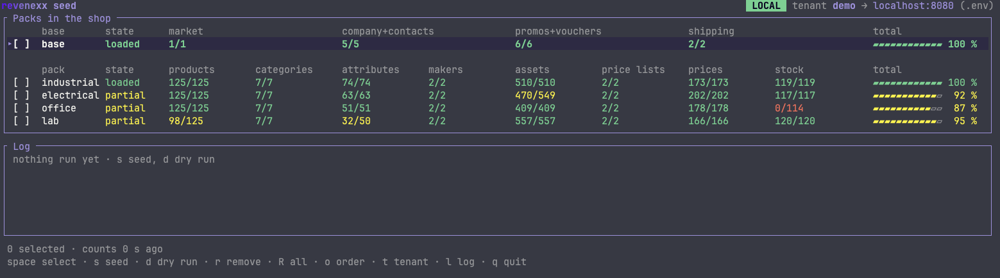

# Sample Data

A ready-made B2B shop for a revenexx tenant: four industry catalogues
(`industrial`, `electrical`, `office`, `lab`) with prices, stock, images,
drawings and 3D models, plus a base with a market, a buyer company and
promotions. `./sample-data` loads and removes them, in a terminal UI or with
flags for CI and scripts.

The [README](https://github.com/revenexx/sample-data#readme) is the full guide:
what each pack holds, what a load changes on the tenant, what removing leaves
behind, and how to build a pack of your own.

## How it is built

- **Plain files.** Every record is JSON under `base/` and `packs/<pack>/`; a
  `manifest.json` per folder lists the steps in load order.
- **One loader.** `lib/load.sh` and `lib/remove.sh` call the revenexx API.
  Beyond the usual Unix tools they need only `bash`, `curl` and `jq`.
- **The terminal UI** in `tui/` is a Node project (Ink, React) that drives the
  loader and reads its progress.
- **Generators** in `tools/` write the packs, photos, drawings and data sheets.
  Loading never needs them.

## Checks

Every pull request runs
[ci.yml](https://github.com/revenexx/sample-data/blob/main/.github/workflows/ci.yml):
format, lint, type check and tests of `tui/`, and `tests/run-lock.sh` for the
loader's one-run lock. Apart from that lock, the data packs, the loader and the
generators have no checks of their own yet.

## Owner

Developer Experience (`@revenexx/developer-experience`).
